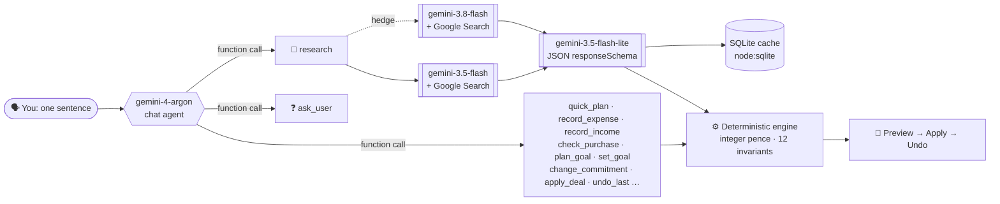

<div align="center">


# MrMoney

### Your student budget, run by a team of Gemini agents.

**Tell it what you spent in one sentence. Gemini re-plans every day until your money runs out, then searches the live web for the deals and rates that make it last longer.**

[](#-the-gemini-stack)
[](#-grounded-and-cited-not-hallucinated)
[](#-agents-and-tools)
[](#-made-with-gemini-end-to-end)

[](https://nextjs.org)
[](https://react.dev)
[](https://www.typescriptlang.org)
[](#-testing)
[](#-privacy)

</div>

---

## 💸 The problem

International students in the UK land with **one pot of money that has to last until a fixed date**: a lump sum from family, or a monthly allowance. Rent, bills and visa rules are fixed. Everything else is guesswork, and the guess is usually "I'll be fine" until week 9.

Spreadsheets don't talk back. Budgeting apps assume a salary. Chatbots make up numbers.

## ⚡ The idea

MrMoney turns your money into a **day-by-day plan** (rent and bills first, then a flexible daily allowance) and lets you change it by talking to it:

> **"I spent £35 on a shower filter today"**
> → Today is covered. £9.16 is taken from later shopping. Rent and your reserve are untouched. **[Undo]**

> **"Can I spend £20 on dinner tomorrow?"**
> → Fits, by borrowing £8.47 from shopping on 12 to 18 Nov. **[Preview, not applied: Apply / Discard]**

> **"I want AirPods by Christmas"**
> → The calendar re-plans itself: treats get swapped for cheaper meals, a little is set aside each day, and the AirPods land on the goal day. Every changed day animates.

> **"Find me the best savings account right now"**
> → Gemini searches the live web, cites every rate, and the engine works out the **£ per year you'd gain by switching**.

**Gemini does the understanding, the reasoning and the research. A deterministic engine does every single sum.** The model never computes an amount, so it can never hallucinate your balance.

---

## 🧠 The Gemini stack

MrMoney runs **five Gemini models**, each picked for its job and benchmarked against the others (latencies measured on 31 Oct 2026, written up in the source):

| Model | Role | Why this model |
|---|---|---|
| **`gemini-4-argon`** | 🧭 The brain. Chat agent, Money agent and Projections decision-maker | Best multi-step function calling and reasoning; `thoughtSignature`s are carried across turns |
| **`gemini-3.5-flash`** | 🔎 Live research with Google Search grounding | 5 to 9 s grounded, 4/4 runs with 6 cited items |
| **`gemini-3.8-flash`** | 🛡️ Hedged backup researcher | Fired automatically if the first researcher is slow or fails |
| **`gemini-3.5-flash-lite`** | ⚡ Structured extraction and the one-sentence parser | **~0.9 s** per parse (down from ~3.5 s) with identical accuracy on the demo set |
| **Nano Banana 2.1** (`gemini-nano-banana-2.1`) | 🎨 Onboarding illustration sketches | Concept art for all 10 onboarding steps, generated through the same Gemini API |

### Every Gemini feature we could put to work

- **🛠️ Function calling.** Argon drives the app through **15 tools** declared straight from Zod schemas, so the model and the server can't disagree about arguments.
- **🌐 Google Search grounding.** Live UK savings rates, cash ISAs, index-fund fees, supermarket meal prices and TfL fares.
- **📐 Controlled generation.** `responseMimeType: application/json` plus `responseSchema` on every extraction, then validated again with Zod.
- **🤔 Tuned thinking levels.** `thinkingLevel` is set per model and per task (`minimal` for extraction, `low` for decisions, the default for chat), all benchmarked.
- **🧵 Thought signatures preserved.** Multi-turn tool calls replay the model's own `contents` exactly, carried in an **HMAC-signed** state blob so the client can't tamper with it.
- **🏁 Hedged parallel requests.** Research races `3.5-flash` against `3.8-flash` under one deadline; the loser is aborted.
- **🧾 Grounding metadata, verified.** Sources come only from `groundingChunks`, and a price counts as grounded only when it appears in a segment that chunk actually supports.

---

## 🤖 Agents and tools



### 🗨️ Chat agent (`/plan`)
Talk to your plan. Argon chooses from 13 app tools plus `research` and `ask_user`: build a 12-month plan from your income, rent and lifestyle (`brokie | balanced | comfy | baller`), log spending, ask "can I afford…", re-plan around a goal, change your rent, apply a deal it found. Anything hypothetical is a **preview** you confirm, and every change has an **Undo**.

### 🏦 Money agent (`/money`)
A second Argon agent with its own toolset (`allocate`, `compare_savings`, `research`, `update_profile`, `ask_user`). It researches live rates and platforms, then hands the numbers to an allocation engine that follows a priority ladder: **debt → overdraft → emergency fund → short goals → Lifetime ISA → index fund → speculative (≤5%)**. The **money map** animates your spare cash flowing into buckets.

### 📈 Projections (`/projections`)
Argon acts as the **deciding agent**: given your lump sum, monthly surplus, horizon and risk profile, it picks the savings/investment split and the specific accounts and ETFs from a catalogue, and explains why in two sentences. If Gemini isn't available, a deterministic engine makes the same decision.

### 🍝 Lifestyle and itinerary research
Four **Google Search–grounded searches run in parallel**: two for recipes and ingredient prices, one for TfL fares, one for the things you want to buy. They become real meals on your calendar with cited prices. A curated fallback catalogue means it never comes back empty.

---

## 🛡️ Grounded and cited, not hallucinated

The rule: **the model reads, the engine counts.**

- 💷 All money is **integer pence**. No floats, no clock inside the engine, no AI arithmetic.
- ✅ 12 engine invariants: nothing goes negative, cash is never spent before it arrives, nothing is double-counted, rent and the reserve are protected, the same transaction applied twice is a no-op, and Undo restores the exact previous state. They're enforced with **property-based tests** (fast-check).
- 🔗 Every rate and deal shows its source. Prices the search didn't support are marked low confidence and link to the retailer's search page.
- ❓ Ambiguous input ("I spent $20") gets a clarifying question and changes nothing.
- 🧯 **Graceful degradation everywhere.** No key, a timeout or a failed call? The parser falls back to a deterministic demo parser, research falls back to curated data, projections fall back to the engine. The UI always labels which one you're seeing ("Read by Gemini" or "Demo parsing").

## 🔒 Privacy

Your plan lives **only on your device** (localStorage). There are no accounts and no database of users. The Gemini key is server-side only, sent in the `x-goog-api-key` header, and never reaches the browser. The only thing cached on the server is public search results.

---

## 🚀 Quick start

```bash
pnpm install
cp .env.example .env.local     # add GEMINI_API_KEY=... (from Google AI Studio)
pnpm dev                       # http://localhost:3210
```

Hit **Try a demo student** for a ready-made plan, then try:

```text
I spent £35 on a shower filter today
Can I spend £20 on dinner tomorrow?
can i afford a £60 concert ticket on saturday
I want a basketball
Find me the best savings account right now
```

No key? It still runs, using the deterministic demo parser and curated data, and says so on screen.

The full 3-minute walkthrough is in [docs/demo-script.md](docs/demo-script.md).

## 🧰 Tech

| Layer | Stack |
|---|---|
| AI | Gemini API (REST, `v1beta`): `gemini-4-argon`, `gemini-3.5-flash`, `gemini-3.8-flash`, `gemini-3.5-flash-lite` |
| App | Next.js 16 App Router, React 19, TypeScript, Tailwind v4, Radix UI, ReUI, lucide |
| Validation | Zod 4, used for both the tool schemas sent to Gemini and the response checks |
| Cache | SQLite through Node's built-in `node:sqlite` (no dependency) |
| Tests | Vitest + fast-check (property tests), Playwright (desktop 1440×1000 and mobile 390×844) |

## 🗂️ Project structure

```text
src/app/              routes: /onboarding /plan /money /projections /settings
src/app/api/          chat · money · parse · itinerary · projections/decide
src/lib/agent/        Argon chat loop, tool declarations, grounded research, signed state
src/lib/finance/      Money agent loop, allocation engine, product catalogue
src/lib/lifestyle/    lifestyle menus, goal re-planning (plan_goal)
src/lib/itinerary/    parallel grounded research → meals, fares and wants on the calendar
src/lib/engine/       the deterministic budget engine (pence, invariants, diff, explanations)
src/lib/parser/       Gemini flash-lite parser + deterministic fallback
src/lib/cache/        persistent SQLite search cache
src/components/       chat, plan calendar, money map, projections, onboarding, ui
e2e/                  Playwright journeys
```

## 🧪 Testing

```bash
pnpm test          # 289 Vitest tests: engine invariants, agent loop, research, parser, store, cache
pnpm test:e2e      # Playwright demo journey + a11y/layout (start `pnpm dev` first)
pnpm typecheck && pnpm lint
```

Live smoke tests against the real Gemini API are in `src/lib/*/smoke.ts`.

---

## ✨ Made with Gemini end to end

Gemini isn't just inside the product; it helped make it:

- 🎨 **The onboarding art** started as 10 sketches generated with **Nano Banana 2.1** through the Gemini API (script in `.prd-to-production/design/tools/gen_sketches.py`).
- 🧑‍💻 The repo ships agent context for **Gemini CLI** (`GEMINI.md`, `.gemini/`) so Gemini can navigate and extend the codebase.
- 📋 The project was built PRD-first with a team of agents: brief, research, design mockups, approval gates and QA rounds are all in [`.prd-to-production/`](.prd-to-production), with decisions in [decision.md](decision.md), the architecture in [architecture.md](architecture.md) and the visual system in [design.md](design.md).

## ⚠️ Honest limitations

No bank connection (figures are what you tell it), GBP only, one user per device, and **not financial advice**: projections are labelled as projections. The full list is in [docs/limitations.md](docs/limitations.md).

<div align="center">

**Built at a hackathon for international students who'd rather not run out of money in week 9.**

⭐ Star it if Gemini just saved you a spreadsheet.

</div>
