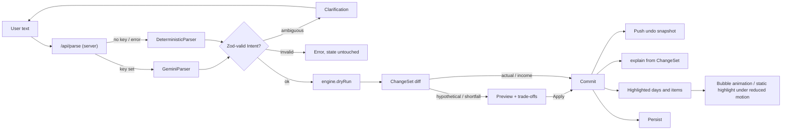

# Architecture — MrMoney

> **Draft, proposed.** Pending approval of [brief.md](.prd-to-production/brief.md) and D3–D8 in [decision.md](decision.md). No app code exists yet.

## 1. Overview

A PWA (Next.js App Router, TypeScript, Tailwind) on Vercel's free tier (D3, D4), with state only in localStorage (D8). The only server code is `/api/parse`: Gemini (Flash-class) when `GEMINI_API_KEY` is set, else a deterministic parser (D5). A pure client-side engine computes every amount; AI never does.

## 2. Module map (R-data)

New behaviour plugs in at each seam without changing callers (open–closed).

| Module | Responsibility | Contract (sketch) | Expected variations | Seam |
|---|---|---|---|---|
| profile | Funds, horizon, reserve, goals, priorities, category weights | `validateProfile(p): Result<Profile, FieldErrors>` | New optional fields (diet, memberships) | Schema versioning + migrations |
| ledger | Append-only actual expenses and income | `append(tx): Ledger` (no-op if `idempotencyKey` is already present) | Edit or delete an actual | Events stay immutable; edits are compensating entries |
| commitments | Expand recurring bills onto due dates | `occurrences(c, from, to): Occurrence[]` | Weekly, termly, one-off | `RecurrenceRule` union |
| allocations | Per-day, per-category planned amounts | `allocate(pool, days, weights, cashLimits): Allocation[]` | Weighting strategies | `AllocationStrategy` interface |
| parser | Text → validated `Intent` | `interface IntentParser { parse(text, ctx): Promise<ParseResult> }` | `GeminiParser`, `DeterministicParser` (labelled "demo parsing") | Adapter chosen by the server from the env |
| engine | Apply an intent to a plan | `plan(state): Plan`, `dryRun(state, intent): ChangeSet` | New intent kinds | `IntentHandler` registry keyed by `intent.kind` |
| preview/explain/undo | Diff, explanation text, history | `diff(a, b): ChangeSet`, `explain(cs): string[]`, `UndoStack.push/pop` | Explanation tone and locale | Explanation templates per intent kind |
| projections | Savings, investment and income over N months | `interface ProjectionModel { project(a: ProjectionAssumptions, months): Series[] }` | Monthly compounding now; contributions later | Swappable model |
| offers | Labelled sample offers matched to the plan | `interface OfferSource { list(ctx): Promise<Offer[]> }` | `CuratedOfferSource`, optional `MapsGroundingSource` (D9) | Composite source that falls back to curated data |

`Intent` is a union (`expense | hypothetical | income | commitmentChange | preference | goal | clarify`), Zod-validated on the server and again on the client.

## 3. Data model

All money is `{ pence: number /* integer */, currency: 'GBP' }`, and dates are ISO `YYYY-MM-DD`.

- **Profile**: `funds`, `fundsKind: 'lump'|'monthly'`, `startDate`, `endDate`, `employment?{ monthlyPay | hours×rate, payDates }`, `reserve`, `savingsGoal`, `existingSavings`, `categoryWeights`, `priorities`, `area?`, `diet?`, `memberships?`, `demoMode`.
- **Commitment**: `id`, `name`, `amount`, `recurrence{ kind: 'monthly'|'once', day | date }`, `locked`, `category`.
- **Income**: `id`, `amount`, `date`, `source: 'job'|'other'`, `confirmed`.
- **Transaction**: `id`, `idempotencyKey`, `date`, `amount`, `category`, `kind: 'expense'|'income'`, `note`.
- **Allocation**: `(day, category) → planned`, plus `flexible: boolean`.
- **Plan**: `allocations`, `summary{ remaining, reservedForCommitments, reserve, plannedSavings, flexibleRemaining, today }`, `unallocated`, `deficits[]`.
- **ChangeSet**: `intent`, `before`/`after` summary, `days[]{ day, category, from, to }`, `shortfall?`, `tradeoffs?[]`.
- **UndoStack**: up to N full `State` snapshots, restored with deep equality.
- **ProjectionAssumptions**: `months`, `savingsAer{low,base,high}`, `investReturn{low,base,high}`, `startBalances`.

## 4. Accounting model and invariants (R-engine, open decision 3)

`pool = balance + futureConfirmedIncome − (unpaidCommitments + reserve + remainingSavingsGoal)`. The pool is spread over today…end by category weights, subject to cash being available on each day. For each day, `remaining = max(0, planned − actual)`, and any overspend is taken out of future flexible days.

- **I1** Σ future flexible allocations + protected (unpaid commitments, reserve, savings goal) + unallocated = balance + future confirmed income.
- **I2** No allocation, allowance or summary figure is negative. A shortfall appears as a `deficit` and is never clamped away silently.
- **I3** Cash availability: for every day d, cumulative outflows (commitments + allocations) up to d ≤ balance + income dated ≤ d. Income never funds an earlier bill.
- **I4** Protected amounts change only through a settings edit. No intent other than an explicit settings change reduces them.
- **I5** Days before today keep their allocations and actuals. Only future flexible amounts move.
- **I6** No double-counting: an actual reduces that day's remaining amount and is not also counted against the pool.
- **I7** Applying the same transaction twice (same `idempotencyKey`) gives the same state as applying it once.
- **I8** Rounding is deterministic: remainder pence go to the earliest days in a fixed order, and Σ equals the pool exactly.
- **I9** Commitments land on their due dates in every month length, clamped to the last day of the month (e.g. the 31st, or 29 Feb).
- **I10** A preview without Apply leaves state deep-equal to the state before it. Undo after Apply restores the previous state deep-equal.
- **I11** Every number in an explanation equals a field in the `ChangeSet`.
- **I12** The demo fixture (brief open decision 4) gives ≈ £25.84 a day: (£3,900 + £300 − £1,240 rent − £165 utilities − £500 − £150) / 83 days.

## 5. Change pipeline

## 6. Persistence and PWA

- Key `mrmoney:v1` holds `{ schemaVersion, state, undo }`; migrations run in order on load; corrupt or unknown data falls back to onboarding.
- Reset clears the key after a labelled confirmation. Demo mode uses the fixed date 2026-11-10, shown on screen.
- Manifest + service worker cache the app shell for offline use; offline parsing uses the deterministic parser. Nothing syncs to a server.

## 7. Testing strategy

- **Vitest:** at least one test per invariant I1–I12; fast-check properties for I1, I2, I3, I8; recurrence tables across month lengths; golden tests for the six R-nl intents and Zod rejections.
- **Playwright:** the R-demo journey (demo → £35 expense → "£20 dinner tomorrow?" preview → Apply/trade-off → £200 income → Undo), asserting totals and that only changed days highlight; plus reload persistence, reset, desktop/mobile render checks, reduced motion, keyboard.
- **Performance:** replanning the 83-day fixture takes under 1 s.

## 8. Risks and open items

- D3–D8 unapproved; exact Gemini model ID unconfirmed (also gates Maps grounding).
- Overspend cascade vs I3 when income arrives late needs worked examples.
- `software-design-patterns` skill missing; the seams above stand in.
- localStorage is per device and losable (acceptable for a hackathon).
- Maps grounding is a stretch: attribution, no caching, curated fallback.
- Curated offers' `checked` dates must be re-verified before demo day.
